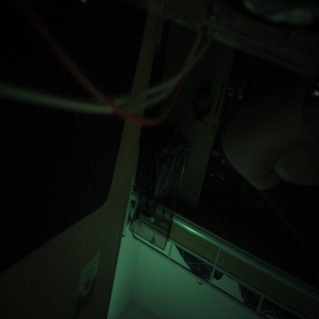

# 河道漂浮垃圾检测 · Orange Pi 5 (RK3588S) 边缘部署

> 在香橙派 5 上用 NPU 做**离线**的河道漂浮垃圾实时检测：MIPI 摄像头取流 → RKNN 模型推理 → ByteTrack 跟踪 → RTSP 带框视频 / OLED 温度屏 / MQTT 手机告警。全部计算在板端完成，不依赖电脑或云端。

<p>
  
  
</p>

---

## 1. 这个项目能干什么

| 模块 | 能力 | 启动方式 |
|---|---|---|
| 拍照 | 从 MIPI 摄像头抓一帧，验证出流 | `python3 scripts/capture.py` |
| 单图推理 | 对一张图做检测，打印结果（不落盘） | `bash scripts/infer.sh bus.jpg` |
| 视频实时推理 | 摄像头连续推理，终端打印检测+跟踪结果 | `python3 scripts/video_infer.py --mode live` |
| RTSP 推流 | 推理画框 + MPP 硬编 → 手机/电脑拉流（**实测 26fps，延迟 <1s**） | 开机自启 `rtsp-stream.service` |
| OLED 温度屏 | SSD1306 显示 5 路温度 + 中文状态 | 开机自启 `thermal-monitor.service` |
| MQTT 告警 | 有垃圾发告警（含各类累计数），无垃圾不发 | 推流脚本内置 |

全部 7 类目标：`塑料瓶 / 塑料杯 / 泡沫 / 塑料袋 / 纸盒 / 易拉罐 / 树叶`

---

## 2. 硬件清单（BOM）

| 部件 | 规格 | 用途 |
|---|---|---|
| 香橙派 5 开发板 | RK3588S，NPU 6 TOPS | 主控 + 推理 |
| MIPI 摄像头 | **OV13855**，接 **Cam3** 接口 | 取流 |
| OLED 屏 | 0.96" SSD1306，I2C 地址 0x3C | 温度显示 |
| 电源 | Type-C 5V/3A 以上 | 供电 |
| 网线 | 任意 | 电脑管理口（可选） |
| 手机/平板 | 装 VLC + 任意 MQTT 客户端 | 看视频 / 收告警（可选） |

### 接线

| 设备 | 接法 |
|---|---|
| OV13855 | MIPI 排线插 **Cam3**，对应 overlay `ov13855-c3` |
| SSD1306 | 26-pin 排针：`1(3.3V) / 9(GND) / 16(SDA) / 18(SCL)`，对应 overlay `i2c1-m4` |
| 网线 | 板子 eth0 ↔ 电脑（默认板端 192.168.137.159） |
| 摄像头取流口 | `/dev/video11`（别名 `/dev/video-camera0`） |

---

## 3. 软件基线（版本必须对齐）

| 项 | 版本 | 说明 |
|---|---|---|
| 系统 | Ubuntu 22.04.5 (Orange Pi 1.2.4 Jammy)，glibc 2.35 | 官方镜像 |
| 内核 | 6.1.99-rockchip-rk3588 | 官方镜像自带 |
| NPU 运行时 | **librknnrt 2.3.2** | 仓库 `lib/librknnrt.so` |
| 模型转换工具 | **RKNN-Toolkit2 2.3.2** | 与运行时**必须同版本**（官方硬约束） |
| 推理 Python 包 | rknn-toolkit-lite2 2.3.2 | `requirements.txt` |

> ⚠️ **版本不一致是最高频的坑**：Toolkit2 版本 ≠ librknnrt 版本时，模型加载直接报错或不推理。换模型/换库必须成对更换。

---

## 4. 五分钟快速开始

> 假设已经烧好官方 Ubuntu 22.04 镜像、能 SSH/adb 连上板子。

### 步骤 1：打开三块硬件的 overlay

编辑 `/boot/orangepiEnv.txt`，`overlays` 一行改成：

```text
overlays=i2c1-m4 ov13855-c3 wifi-ap6275p
```

重启后确认设备存在：

```bash
ls /dev/video11 /dev/i2c-1
```

### 步骤 2：确认 ISP 3A 服务在跑（画面偏绿就是因为没它）

```bash
systemctl status rockchip-isp.service
```

未运行则先按 [docs/02_environment.md](docs/02_environment.md) 安装 `camera-engine-rkaiq` 0.4 版并启用服务。

### 步骤 3：装 Python 依赖

```bash
pip3 install -r requirements.txt
```

> 板端如果没网（常见），按 [docs/02_environment.md](docs/02_environment.md) 的「离线安装」章节，在电脑侧下好 aarch64 wheel 再 `adb push` 过去。

### 步骤 4：一键部署到板端

```bash
# 在板子上，仓库目录内执行
sudo bash deploy/install.sh
```

脚本会：把 `scripts/ models/ bin/ lib/` 复制到 `/home/orangepi/trash_detect/`，安装 4 个 systemd 服务并启动。

### 步骤 5：验证

```bash
# 1) 摄像头出流
python3 ~/trash_detect/scripts/capture.py
# 期望：captured frame: 640x640, xxx KB in RAM

# 2) 模型推理（用仓库自带测试图）
cd ~/trash_detect && bash scripts/infer.sh bus.jpg
# 期望：打印检测框类别/置信度，并提示 inference done

# 3) 全链路自检（摄像头→推理→画框）
python3 ~/trash_detect/scripts/video_infer.py --mode check

# 4) 看视频流（手机/电脑 VLC）
# rtsp://<板子IP>:8554/live/myStream
```

看到带检测框、方向正确、右上角有实时帧率的画面，即为复现成功。

---

## 5. 仓库目录说明

```text
river-trash-detect/
├── README.md                  # 本文件：总览 + 快速开始
├── requirements.txt           # 板端 Python 依赖（版本锁定）
├── LICENSE                    # MIT
├── scripts/                   # 板端全部功能脚本（每个都能独立运行）
│   ├── capture.py             #   模块1：拍照
│   ├── infer.sh               #   模块2：单图推理（C demo）
│   ├── video_infer.py         #   模块3：视频实时推理（check/live/image）
│   ├── rtsp_infer_stream.py   #   模块4：推理+硬编+推流（常驻服务）
│   ├── alert_mqtt.py          #   模块5：MQTT 告警发布
│   ├── thermal_monitor.py     #   模块6：OLED 温度屏
│   ├── mjpeg_stream.py        #   （备用）MJPEG 网页推流
│   ├── uvc_stream.py 等        #   （备用）USB UVC 图传
│   ├── listen_alert.py        #   MQTT 订阅测试
│   ├── smoke_tracker.py       #   跟踪器冒烟测试
│   └── tracker/               #   ByteTrack（basetrack/byte_tracker/kalman_filter/matching）
├── models/
│   ├── best_opt.rknn          # 部署模型（RKNN，FP16，7 类，mAP50=0.8303）
│   └── coco_80_labels_list.txt
├── bin/rknn_yolov8_demo       # 官方 C demo（ARM64，交叉编译产物）
├── lib/
│   ├── librknnrt.so           # NPU 运行时 2.3.2
│   └── librga.so              # RGA 图像加速
├── deploy/                    # systemd 服务 + 一键安装脚本
│   ├── install.sh
│   ├── rtsp-stream.service
│   ├── mediamtx.service
│   ├── create_ap.service
│   ├── thermal-monitor.service
│   └── rockchip-isp.service
├── configs/                   # 需要放到系统位置的配置
│   ├── mediamtx.yml           # RTSP/RTMP 服务器配置
│   ├── mosquitto.conf         # MQTT 主配置
│   ├── mosquitto_external.conf# 监听 0.0.0.0:1883（手机可连）
│   └── orangepiEnv.txt        # overlay 示例
├── notebooks/                 # 训练与实测对比（不是运行必需）
├── logs/                      # 完整项目开发日志 13 篇（踩坑全过程）
├── docs/                      # 分步复现文档（见下）
└── assets/                    # 效果图
```

---

## 6. 文档索引（按顺序看就能复现）

| 文档 | 内容 |
|---|---|
| [docs/01_hardware.md](docs/01_hardware.md) | 硬件清单、接线、摄像头/OLED 参数 |
| [docs/02_environment.md](docs/02_environment.md) | 系统 overlay、ISP 3A、apt/pip 依赖、**离线安装** |
| [docs/03_model.md](docs/03_model.md) | 模型来源与指标、pt→onnx→rknn 转换链路、版本匹配 |
| [docs/04_deploy.md](docs/04_deploy.md) | install.sh 做了什么、服务与启动顺序 |
| [docs/05_run_and_verify.md](docs/05_run_and_verify.md) | 每个模块的独立运行方式与预期输出 |
| [docs/06_mqtt_alert.md](docs/06_mqtt_alert.md) | MQTT 配置、消息格式、手机订阅步骤 |
| [docs/07_benchmark.md](docs/07_benchmark.md) | 实测数据（13 张考试图 + 帧率/延迟/温度） |
| [docs/08_faq.md](docs/08_faq.md) | 常见坑与排查（偏绿、时间戳、跟踪崩溃、容器 NPU 等） |

---

## 7. 输出方式

### 7.1 RTSP 视频

```text
rtsp://<板子IP>:8554/live/myStream
```

VLC 网络缓存设 **50ms** 可把延迟压到 1 秒内（MediaMTX 官方建议）。

### 7.2 MQTT 告警

- Broker：板端本机 `mosquitto`，端口 `1883`（`configs/mosquitto_external.conf` 已开放 `0.0.0.0`）
- 主题：`trash_detect/alert`
- 有垃圾时消息示例：

```json
{
  "event": "trash_detected",
  "status": "active",
  "time": "2026-11-05 22:00:00",
  "source": "rtsp",
  "counts": {"塑料瓶": 1},
  "totals": {"塑料瓶": 3, "塑料袋": 1},
  "items": [{"class": "塑料瓶", "conf": 0.9, "track_id": 12, "bbox": [270,220,370,420]}],
  "image": ""
}
```

- `counts` = 当前帧各类数量；`totals` = 本次开机以来各类累计（按 `track_id` 去重，**重启清零**）
- **无目标时不发送任何消息**（手机端警报自动消失，不做双状态）
- 手机 App 配置见 [docs/06_mqtt_alert.md](docs/06_mqtt_alert.md)

### 7.3 OLED 温度屏

单页 5 行：芯片 / 大核 / 小核 / GPU / NPU 温度，右侧竖排状态字：`正常 / 高温(>75℃) / 请降温(>85℃) / 停止使用(>105℃)`。

---

## 8. 实测结果（如实记录）

13 张考试图（1 张正样本 + 12 张负样本，负样本为室内杂乱/暗光场景）：

| 指标 | 结果 |
|---|---|
| 正样本检出 | 3/3 命中（置信度 0.90 / 0.79 / 0.78），漏检 0 |
| 框级 Recall | 100%（3/3） |
| 框级 Precision | 21.4%（3/14） |
| 负样本误报 | 6/12 张误报，共 11 框（置信度 0.29~0.65） |
| 告警漏报率 | 0% |
| 告警误报率 | 50% |

**结论**：真实垃圾目标检出可靠（不漏）；短板是室内杂乱场景下的低置信误报。把 `OBJ_THRESH` 从 0.25 提到 0.5 可消掉 7/11 误报，但会牺牲部分召回——本项目 v1 未启用该阈值。

运行性能（单核 NPU 跑视频链路）：

| 项 | 数值 |
|---|---|
| 推流帧率 | 26 fps |
| RTSP 延迟 | < 1 s（VLC 缓存 50ms） |
| 板端温度 | 55~60 ℃ |
| 推理耗时 | 约 50 ms/帧（Docker 内实测） |

模型指标：YOLOv8n + 蒸馏 v1.2，FP16，**mAP50 = 0.8303**。

---

## 9. 常见问题（详见 docs/08_faq.md）

| 现象 | 原因 |
|---|---|
| 画面整体偏绿 | `rockchip-isp.service` 没启动（3A 未接管） |
| `ERROR: cannot open /dev/video11` | overlay 没开 `ov13855-c3`，或摄像头没接 Cam3 |
| 加载模型报版本错误 | `librknnrt` 与 Toolkit2 版本不一致 |
| 推流一有目标就崩 `TypeError: int - tuple` | `matching.py` 的 `bbox_ioa` 旧版返回二元组，本仓库已修复 |
| 板子 apt/pip 全部超时 | 板端无外网，必须走电脑侧下载 + 离线安装 |
| 容器内 NPU 报缺 `renderD129` / device-tree | 需 `--privileged` + 整目录挂载 `/proc/device-tree`（本项目已不采用容器） |

---

## 10. 参考依据

- 香橙派官方 Wiki：https://wiki.orangepi.cn/ （摄像头、OLED、overlay 章节）
- RKNN-Toolkit2 / rknn_model_zoo（2.3.2）：https://github.com/airockchip/rknn-toolkit2
- MediaMTX 官方文档：https://github.com/bluenviron/mediamtx
- Eclipse Paho MQTT Python：https://pypi.org/project/paho-mqtt/
- ByteTrack（ultralytics 实现）：https://github.com/ifzhang/ByteTrack
- 完整踩坑记录见 `logs/` 目录 13 篇日志

## 11. 许可

MIT License，见 [LICENSE](LICENSE)。
